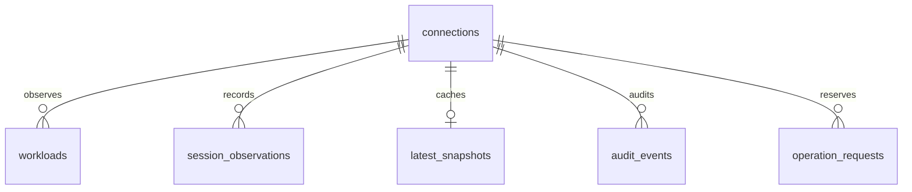

# Application Database

## Boundary

Backup Center uses a dedicated `backupcenter` database on the user-provided PostgreSQL host. The server was inspected through its SSH login and runs PostgreSQL 14.22. The Bareos Catalog remains separate and is not modified by this implementation.

`POSTGRES_HOST`, `POSTGRES_USERNAME`, and `POSTGRES_PASSWORD` describe the host SSH login for provisioning. They are not PostgreSQL role credentials. Runtime code uses only the generated `BACKUPCENTER_DB_*` settings.

## Schema



| Table | Purpose | Key and constraints |
|---|---|---|
| schema_migrations | Applied migration versions and checksums | Version primary key; applied migration contents must not change |
| connections | Bareos data-source identity | Deterministic UUID scoped to API base URL |
| workloads | Observed VMware job mappings | UUID; unique connection/job pair; inventory identity remains unset until vCenter reconciliation |
| session_observations | Durable normalized session observations | Connection/JobId composite primary key |
| latest_snapshots | Last normalized monitoring snapshot | One per connection; original synchronization time retained |
| audit_events | Collector persistence events | Append-only privileges for the runtime role; timestamp/index |
| operation_requests | Durable Run/Cancel and gated isolated-restore intents; provisioning remains unused | Connection/idempotency-key uniqueness; constrained kind/state |

Job names represent configuration mappings, not stable VMware identities. Renaming a job creates a separate observed mapping; future vCenter reconciliation must use inventory identifiers. A workload is marked unconfigured only after a complete jobs/FileSets source read; partial reads do not infer removals.

Saved sessions are observations, not retained backup media. They can outlive Catalog records, so they are not merged back into the live Backups view or treated as recoverable points. The archive supplies bounded observed-session reports/CSV; it remains separate from live recovery evidence.

## Runtime permissions

`backupcenter_runtime` has LOGIN and no SUPERUSER, CREATEDB, CREATEROLE, or REPLICATION privileges. The schema and tables remain owned by the database administrator. Runtime grants are SELECT/INSERT/UPDATE on operational tables and SELECT/INSERT on audit_events. Runtime cannot create schema objects or update/delete audit events. It has no DELETE grants.

These restrictions are not a cryptographic tamper-proof audit system; database administrators retain administrative authority. No privileges on other application tables are granted by this project. PostgreSQL PUBLIC defaults in unrelated databases are not modified.

## Transport and secrets

The client uses TLS with `verify-ca` and the PostgreSQL host's public self-signed certificate retrieved through SSH. Certificate-chain validation is enabled; hostname verification is not provided by `verify-ca`. Use a properly issued certificate and `verify-full` when introducing a production PKI. Private certificate keys are never copied.

The public trust certificate is stored in ignored `.local/postgres-ca.pem`. The generated role password is stored only in ignored `.env` with owner-only permissions. No password is printed or sent to the frontend.

## Provisioning and migrations

```sh
.venv/bin/python scripts/bootstrap_database.py
```

The script uses the supplied host SSH login and sudo to invoke local PostgreSQL administration. It refuses existing database/role names without matching managed configuration, saves the generated password before remote creation for recovery, creates isolated resources, applies the checksummed initial migration, grants restricted privileges, and verifies runtime TLS login.

Initial schema migration is transactional. PostgreSQL database/role creation is not atomic with local credential storage; rerunning the bootstrap recovers a partial creation using the saved credential. No cleanup drops databases or roles automatically. Migration checksum mismatches fail closed. Future schema changes require new migration files and a corresponding migration runner extension.

Only one bootstrap process should run at a time. Migration application uses advisory locking, but the external provisioning and local credential file are not a distributed atomic transaction.

## Persistence behavior

On successful live refresh, normalized snapshots, workloads, sessions, and a collector audit event are committed in one database transaction. No raw Bareos config, plugin passwords, or session logs are persisted.

After a new backend instance starts, it loads the latest saved snapshot before attempting a live refresh. If Bareos is unavailable, the saved data is returned as stale with its original timestamp. PostgreSQL failure does not block read-only live monitoring; the UI explicitly reports that durability is unavailable. Run/Cancel controls fail closed when their operation journal cannot be persisted.

Audit history is visible in Settings and bounded to the latest 100 events with independent pagination. Collector identity is `local-collector`; application user attribution remains a future authentication feature.

## Verification evidence

The dedicated database was provisioned, runtime TLS connectivity verified, the migration rerun successfully, and live data persisted for six workloads and seven sessions at inspection. Effective role/schema/audit privileges were checked. A fresh adapter instance recovered the actual saved snapshot during a simulated upstream API outage. No backup or restore job was run.

## Retention and next steps

Audit and observation retention is not automated yet. Table growth must be monitored; implement an administrator-owned retention policy before unattended long-term operation. Database backup/restore and recovery objectives require an operational runbook and restore test. Run/Cancel dispatch and worker reconciliation are implemented in OPERATIONS.md. Policies, application users, restore, and VMware provisioning remain later phases.

## References

- [PostgreSQL database creation](https://www.postgresql.org/docs/14/sql-createdatabase.html)
- [Psycopg transaction and connection behavior](https://www.psycopg.org/docs/usage)

## Additive inventory, identity and workflow migrations

002/003 store inventory snapshots and connection-scoped VM observations with soft visibility and historical MoRef reuse. 004 stores local users and hashed sessions. 005 constrains restore destination/mode/overwrite in the journal. 006 stores draft policy revisions/definitions and creator ownership. 007 stores observed session alert evidence/state/revision. 008 stores provisioning configuration revisions and per-VM staged assignments for dry-run onboarding rehearsal. The migration runner applies sorted new files and rejects checksums that differ from already-applied versions. Runtime has explicit SELECT/INSERT/UPDATE on these operational tables and no DDL/delete grants; audit remains SELECT/INSERT only.

Local identity audit events are connection-independent and are included in the single-environment audit view. Future multi-site deployments must introduce appropriate identity/event scopes before reusing this behavior.
